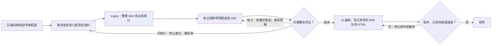

# Loop／graph 與一次執行

每份原文各做一次來源與範圍核對；每個問題各跑查詢和覆蓋檢查。只有缺資料才重查；程式最多允許兩輪，沒新結果就停止。若仍有缺口，不發佈失敗簡報，由編輯回到原文補材料。最終版本或引用錯誤不靠重試碰運氣，而是修正原因後再建置。

## 基線與修正版

- [`00-ingest.json`](records/00-ingest.json)：六份第一手文件，五個概念頁，十四個主張。
- [`01-baseline.json`](records/01-baseline.json)：前 3 筆關鍵字結果先形成草稿要點，再做覆蓋檢查；五題中兩題缺資料。
- [`02-early-gate.json`](records/02-early-gate.json)：把檢查提前至查詢後、編排前；針對缺少的概念重查，兩題各重查一輪，五題通過。
- [`04-render.json`](records/04-render.json)：九頁簡報與 Wiki 主張／原始資料對應，六個來源均有對應投影片。
- [`05-check.json`](records/05-check.json)：四個公開 HTML 路徑、內部錨點與引用對應通過。四個刻意製造的負面測試獨立標記，不算基線錯誤。

查詢是這次最常有問題的節點：延遲指標查到了 APC 限制卻漏掉完成時間；快取查到了 prefill 工作卻漏掉沒有前綴／長輸出的適用限制。把覆蓋檢查移到編排前能避免在缺少依據時先寫完簡報。詞彙匹配與分類仍可能錯，語意核對須回到原文；這次結果不代表所有新問題都能一次通過。
